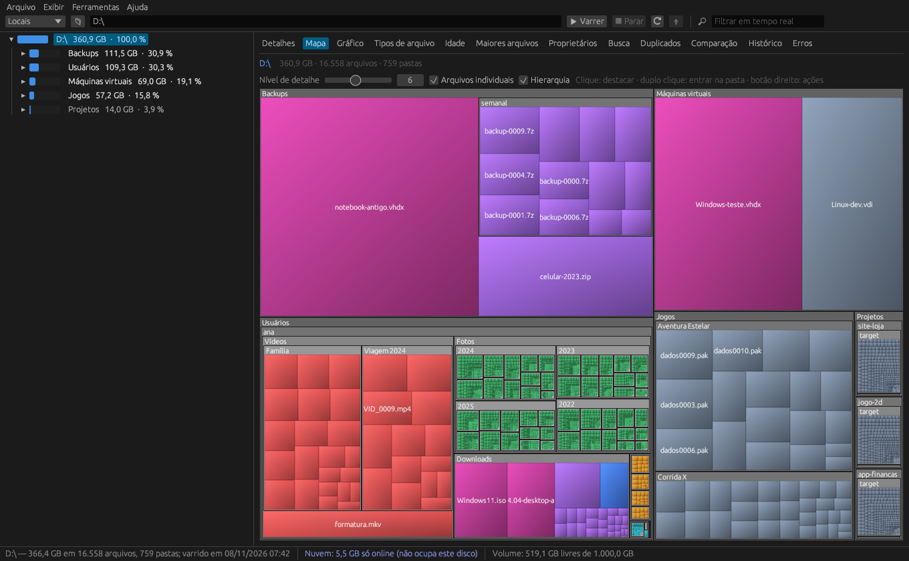

<p align="center"></p>

<h1 align="center">AtlasDisco</h1>

<p align="center">
  <b>See what is filling your disk.</b> A fast, open source disk space analyzer for Windows, Linux and macOS.<br>
  <a href="https://jhordanleandro.github.io/AtlasDisco">Website</a> ·
  <a href="https://github.com/jhordanleandro/AtlasDisco/releases/latest">Download</a> ·
  <a href="README.pt-BR.md">Português</a>
</p>

<p align="center"></p>

## Features

| Area | What it does |
|---|---|
| **Scanning** | Multithreaded scan, paths longer than 260 characters, network shares (UNC), logical size and allocated size (NTFS compression and sparse files), junctions and symlinks are not followed by default, hardlinks counted once (option), NTFS alternate data streams (option), include/exclude filters (wildcards or regex) |
| **Cloud-aware** | OneDrive / Files On-Demand placeholders are detected and counted separately ("cloud only", not taking disk space). Duplicate and content searches never touch them, so nothing gets downloaded by accident. The locations list separates physical disks from cloud folders |
| **Views** | Folder tree with size bars, 16-column details view, squarified treemap, pie/bar charts, file types, file age, largest files, owners, real-time filter, light/dark theme |
| **Search** | Name (wildcards/regex), size, dates, path length, depth, attributes and file **content**; presets (large, old, temporary, long paths, empty folders); saved search templates |
| **Duplicates** | Size → first 64 KB hash → full SHA-256 or MD5 (or name + size); auto-mark copies keeping the oldest; replace copies with hardlinks |
| **Bulk operations** | Recycle bin, delete, copy/move keeping the folder structure, regex batch rename with preview, NTFS compress/uncompress |
| **Reports** | Excel (.xlsx), CSV, HTML, PDF, TXT, JSON and SQLite, with configurable depth; e-mail from the CLI |
| **Growth tracking** | Snapshots (`.atlas`), comparison between scans, automatic per-folder history with chart |
| **Automation** | `atlasdisco-cli` (scan, search, duplicates, compare, history, schedule) and scheduled scans (Windows Task Scheduler or cron) |
| **Integration** | Explorer context menu, restart as administrator, drag a folder onto the window, portable mode |

The interface is currently in Brazilian Portuguese; translations are welcome.

## Download

| System | Package |
|---|---|
| Windows 10/11 (x64) | [AtlasDisco-windows-x64.zip](https://github.com/jhordanleandro/AtlasDisco/releases/latest/download/AtlasDisco-windows-x64.zip) |
| Windows on ARM | [AtlasDisco-windows-arm64.zip](https://github.com/jhordanleandro/AtlasDisco/releases/latest/download/AtlasDisco-windows-arm64.zip) |
| macOS 11+ (Apple Silicon and Intel) | [AtlasDisco-macos-universal.dmg](https://github.com/jhordanleandro/AtlasDisco/releases/latest/download/AtlasDisco-macos-universal.dmg) |
| Linux x64 (Debian/Ubuntu) | [.deb](https://github.com/jhordanleandro/AtlasDisco/releases/latest/download/AtlasDisco-linux-x64.deb) · [.tar.gz](https://github.com/jhordanleandro/AtlasDisco/releases/latest/download/AtlasDisco-linux-x64.tar.gz) |
| Linux ARM64 | [.deb](https://github.com/jhordanleandro/AtlasDisco/releases/latest/download/AtlasDisco-linux-arm64.deb) · [.tar.gz](https://github.com/jhordanleandro/AtlasDisco/releases/latest/download/AtlasDisco-linux-arm64.tar.gz) |
| Android | planned |

The binaries are not code-signed yet:
- **Windows**: SmartScreen may show "Windows protected your PC"; click *More info → Run anyway*. The zip is portable (`portatil.txt` keeps settings next to the program; delete it to use the user profile).
- **macOS**: Gatekeeper may block the first launch; right-click the app → *Open*, or run `xattr -dr com.apple.quarantine /Applications/AtlasDisco.app`.

## Command line

```sh
atlasdisco-cli varrer D:\ --top 20 -e report.xlsx -e report.pdf --historico
atlasdisco-cli buscar D:\ --nome "*.iso;*.vhdx" --min 1GB -e large.csv
atlasdisco-cli duplicados D:\Photos --min 100KB -e duplicates.xlsx
atlasdisco-cli comparar yesterday.atlas D:\ --profundidade 3
atlasdisco-cli agendar daily-d --hora 03:00 -- varrer D:\ --historico -e C:\Reports\D_{data}.xlsx
```

Run `atlasdisco-cli --help` for every option.

## Building from source

Requires Rust 1.80+.

```sh
cargo build --release      # target/release/atlasdisco and atlasdisco-cli
cargo test --workspace
```

- **Windows**: Visual Studio Build Tools (MSVC linker).
- **Linux**: `sudo apt install libgtk-3-dev libxkbcommon-dev libwayland-dev libxcb-render0-dev libxcb-shape0-dev libxcb-xfixes0-dev`
- **macOS**: Xcode command line tools.

Project layout: `crates/core` (scanning, analysis, search, duplicates, snapshots, export), `crates/gui` (egui interface), `crates/cli` (command line), `site/` (website), `test/` (end-to-end tests).

## Roadmap

- Android app
- Remote sources: Linux over SSH, Amazon S3 and compatibles, Azure Blob, WebDAV (core implemented, UI pending)
- NTFS permissions view (core implemented, UI pending)
- Live results while scanning (core implemented, UI pending)
- English interface and other languages
- Signed Windows and macOS builds

## Contributing

Issues and pull requests are welcome; see [CONTRIBUTING.md](CONTRIBUTING.md).

## License

Licensed under either of [MIT](LICENSE-MIT) or [Apache-2.0](LICENSE-APACHE) at your option.
Unless you explicitly state otherwise, any contribution you submit shall be dual licensed as above, without any additional terms or conditions.
