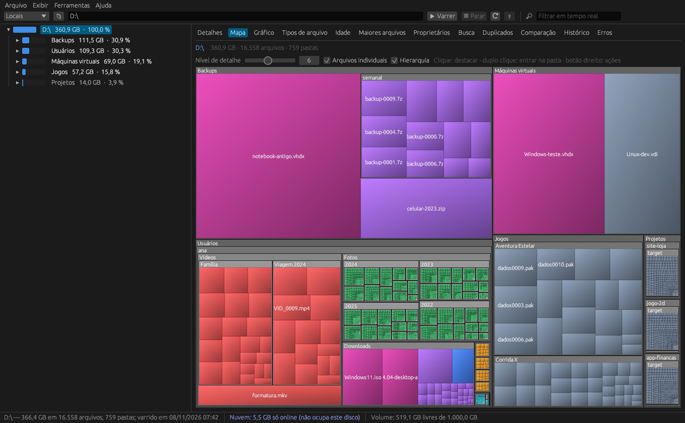

<h1 align="center">AtlasDisco</h1>

  <b>Veja o que está enchendo o seu disco.</b> Analisador de espaço em disco rápido e de código aberto para Windows, Linux, macOS e Android. 
  <a href="https://jhordanleandro.github.io/AtlasDisco">Site</a> ·
  <a href="https://github.com/jhordanleandro/AtlasDisco/releases/latest">Baixar</a> ·
  <a href="README.md">English</a>

## Funções

| Área | O que faz |
|---|---|
| **Varredura** | Paralela, caminhos com mais de 260 caracteres, compartilhamentos de rede, tamanho e espaço alocado (compressão NTFS e arquivos esparsos), não segue junções/links por padrão, hardlinks contados uma vez (opção), fluxos alternativos NTFS (opção), filtros por curinga ou regex |
| **Nuvem separada** | Arquivos sob demanda do OneDrive e similares são detectados e contados à parte ("só na nuvem", não ocupam o disco). Duplicados e busca por conteúdo nunca os abrem, então nada é baixado sem querer. A lista de locais separa discos físicos de pastas de nuvem |
| **Visualização** | Árvore com barras, detalhes com 16 colunas, mapa de árvore, pizza/barras, tipos de arquivo, idade, maiores arquivos, proprietários, filtro em tempo real, tema claro/escuro |
| **Busca** | Nome (curingas/regex), tamanho, datas, comprimento do caminho, nível, atributos e **conteúdo**; atalhos prontos; modelos de busca salvos |
| **Duplicados** | Tamanho → hash dos primeiros 64 KB → SHA-256 ou MD5 completo (ou nome + tamanho); marca as cópias mantendo o mais antigo; troca cópias por hardlinks |
| **Operações em massa** | Lixeira, exclusão, copiar/mover mantendo a estrutura, renomear em massa por regex com prévia, compactar/descompactar NTFS |
| **Relatórios** | Excel (.xlsx), CSV, HTML, PDF, TXT, JSON e SQLite, com profundidade configurável; e-mail pela linha de comando |
| **Crescimento** | Instantâneos (`.atlas`), comparação entre varreduras, histórico automático por pasta com gráfico |
| **Automação** | `atlasdisco-cli` (varrer, buscar, duplicados, comparar, histórico, agendar) e varreduras agendadas |
| **Integração** | Menu de contexto do Explorer, reiniciar como administrador, arrastar pasta para a janela, modo portátil |

## Baixar

Os pacotes de cada sistema ficam na [última versão](https://github.com/jhordanleandro/AtlasDisco/releases/latest): Windows (x64 e ARM), macOS (universal), Linux (.deb e .tar.gz, x64 e ARM64) e Android 8+ ([APK](https://github.com/jhordanleandro/AtlasDisco/releases/latest/download/AtlasDisco-android.apk); na primeira abertura, conceda “acesso a todos os arquivos”).

Os executáveis ainda não têm assinatura digital:
- **Windows**: se o SmartScreen avisar, clique em *Mais informações → Executar assim mesmo*.
- **macOS**: na primeira vez, clique com o botão direito no app → *Abrir*, ou rode `xattr -dr com.apple.quarantine /Applications/AtlasDisco.app`.

O pacote do Windows vem em modo portátil (arquivo `portatil.txt`): as configurações ficam na própria pasta. Apague esse arquivo para guardá-las no perfil do usuário.

## Compilar

Rust 1.80+: `cargo build --release` e `cargo test --workspace`. Veja as dependências de cada sistema no [README em inglês](README.md#building-from-source).

## Licença

[MIT](LICENSE-MIT) ou [Apache-2.0](LICENSE-APACHE), à sua escolha.
